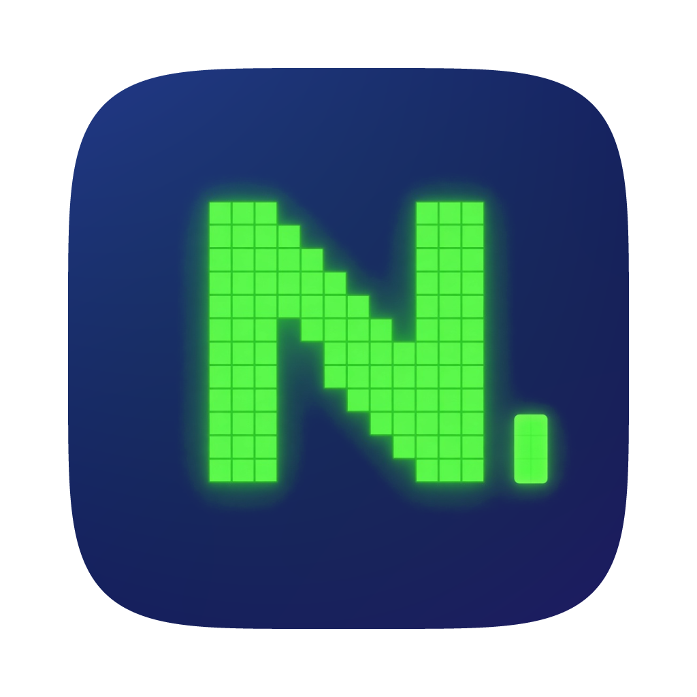

<p align="center">
  
</p>

<h1 align="center">MyGoNVim</h1>

<p align="center">
  <a href="README.md">English</a> &middot;
  日本語 &middot;
  <a href="README.zh-CN.md">中文</a>
</p>

<p align="center">
  macOS と Windows 向けの Neovim GUI。MyGo のネイティブ UI で構築しています。
</p>

<p align="center">
  <a href="https://github.com/r404r/mygonvim/actions/workflows/ci.yml"></a>
</p>

<p align="center">
  <a href="#ビルド済みバイナリ">ビルド済みバイナリ</a> &middot;
  <a href="#実行">実行</a> &middot;
  <a href="#マウス">マウス</a> &middot;
  <a href="#クリップボード">クリップボード</a> &middot;
  <a href="#フォント">フォント</a> &middot;
  <a href="#ポータブルモード">ポータブルモード</a> &middot;
  <a href="#開発">開発</a>
</p>

[Neovim](https://neovim.io) の GUI で、[MyGo](https://github.com/egoist/mygo) のネイティブ UI で描画します。Go のみで、cgo も web view も使いません。対象は Windows と macOS です。Linux は開発に使えます。

`nvim --embed` を起動し、Neovim のセルグリッドをメモリに保持し、MyGo の `ui.Shape` と `Painter.Glyphs` でセルごとに描画します。

**状態: MVP ステップ 1（部分的）、バージョン 0.0.9。** Linux では検証済みです（単体テストと結合テスト、実ウィンドウ、および CI）。ファイルを開き、編集して保存できます。構文の色、CJK と絵文字、モードごとのカーソル形状、ウィンドウタイトル、ウィンドウのリサイズ、Ctrl/Alt/特殊キーも同様です。入力メソッドの変換中文字列は、ヘッドレスのテストでカーソル位置に描画されます。macOS と Windows での実際の IME は未検証です。macOS と Windows はコンパイルでき、CI の単体テストに通り、署名のないプレビュービルドもありますが、実機ではまだ実行していないため、MVP 1 は完了していません。マウスホイールとタッチパッドは、ポインタ下のウィンドウをスクロールします（ヘッドレスウィンドウ内の実際の Neovim に対してテスト済みで、実際の Mac または Windows マシンではまだです）。マウスクリックとドラッグも、ヘッドレスウィンドウ内の実際の Neovim に対してテスト済みです。実際の macOS または Windows のハードウェアでは試していません。クリップボードの貼り付けとレジスタのコールバックは、代替クリップボードを使って実際の Neovim に対してテスト済みです。ネイティブのクリップボード交換とメニューのショートカットは、まだ実際の macOS と Windows でのテストが必要です。まだないもの: 高 DPI の仕上げ、コマンドライン / ポップアップメニュー / タブライン / マルチグリッドの UI、同梱の Neovim、署名または公証されたパッケージ。設計メモは別に保守しています。

## ビルド済みバイナリ

`mygo.json` のバージョンは `0.0.9` です。そのバージョンと一致する `v*` タグを push すると [`.github/workflows/release.yml`](.github/workflows/release.yml) が実行され、macOS arm64 と amd64 の `.app` zip および `.dmg`、それに Windows amd64 のポータブル zip（空の `data/` フォルダを含み、Neovim は同梱しません）を、**下書き**の GitHub Release に添付します。v0.0.1、v0.0.2、v0.0.3、v0.0.4 の Release は、引き続き未公開の下書きです。

これらのビルドは署名されていません。macOS アプリはアドホック署名で、公証されていません。他の Mac では Gatekeeper がブロックする可能性が高いです。ビルドは macOS 13.0 を最小バージョンとして宣言しています（`mygo.json` の `macos.minimumSystemVersion`）。

Gatekeeper がアプリをブロックした場合は、まず Finder で Control クリック（右クリック）して Open を選びます。それでも失敗する場合は、`.dmg` から来たアプリを Applications にコピーしてから、次を実行します。

    xattr -dr com.apple.quarantine /path/to/MyGoNVim.app

この方法は、実際の Mac では検証していません。

## 実行

Go 1.27.3 以降（MyGo が要求するバージョン）と、`PATH` 上の Neovim（または `-nvim` を渡す）が必要です。開発とテストは Neovim 0.12（テストでは v0.12.6）で行っています。それより古いバージョンは未検証です。

```sh
# macOS
brew install neovim go
git clone https://github.com/r404r/mygonvim && cd mygonvim
go run . path/to/file.txt          # or: go tool mygo dev
```

```
usage: mygonvim [flags] [file ...]
  -nvim string        path of the nvim executable (default: $MYGONVIM_NVIM, ./nvim/bin, PATH)
  -font string        font family list, e.g. "JetBrains Mono, monospace"
  -font-size float    font size in DIPs (default 14)
  -width, -height     window size in DIPs (default 1000x650)
  -version            print the version and exit
```

`mygonvim -version` は `MyGoNVim <version>` を表示します。`go run` とテストでは `dev` を使います。リリースビルドは `mygo.json` からバージョンを設定し（`go tool mygo build` がアプリにリンクします）、`-ldflags="-X main.version=…"` または環境変数 `MYGO_LDFLAGS`（`go tool mygo build` がこれを追記します）でも設定します。この二つは同じ文字列であるべきで、先頭に `v` は付けません。

nvim を探す場所: `-nvim`、`$MYGONVIM_NVIM`、プログラムの隣の `nvim/bin/nvim[.exe]` または `nvim/nvim[.exe]`（アプリの resources フォルダ内も含む）、`PATH`、それから macOS では `/opt/homebrew/bin` と `/usr/local/bin`。

Finder または Explorer からウィンドウへファイルをドロップすると開きます。MyGoNVim は、Neovim 向けに引用符で囲んだ名前で `:confirm drop {files}` を実行します。既存の Windows パスに含まれるリテラルの `[` も含みます。ドロップしたディレクトリは Neovim のファイルエクスプローラで開きます。最初のファイルが表示されます（すでに開いていれば、そのウィンドウにフォーカスします）。ファイルが複数のときは、すべて引数リストに入ります。現在のバッファに未保存の変更があるとき、Neovim は自身のコマンドラインで確認します。このコマンドは実際の Neovim に対してテスト済みです。ドロップの操作そのものは、実際の macOS または Windows のマシンでは試していません。Dock アイコンへのドロップと "Open With" は、まだ扱っていません。

**File > Open...**（ファイル > 開く...）はシステムのファイルダイアログを表示し（複数のファイルを選べます）、ドロップと同じ方法で選択を開きます。macOS ではショートカットは Cmd+O で、app（アプリケーション）、Edit（編集）、Window（ウィンドウ）の各メニューと File > Close（ファイル > 閉じる）は残ります。Windows では File メニューに、ショートカットのない Open... と Exit（終了）があり、そのため Ctrl+O（ジャンプリスト）、Ctrl+W、Ctrl+Q は Neovim 側に残ります。Linux も同じメニューです。どちらにも Font（フォント）メニューがあります（「フォント」を参照）。ダイアログをキャンセルしても何も起きません。このメニューは、実際の macOS または Windows のマシンでは試していません。

ウィンドウを閉じると `:confirm qa` が実行されます。未保存の変更について Neovim が自身のコマンドラインで確認し、Neovim が終了するとウィンドウが閉じます。

File > Exit と、アプリケーションの Quit（終了）操作は、同じ確認の経路を使います。OS のログアウトまたはシャットダウンの間、MyGo はウィンドウを閉じるイベントのキャンセルを無視します。アプリケーションは、この確認のためにウィンドウを開いたままにできません。OS のセッションを終える前に、作業を保存してください。ネイティブの閉じる操作は、まだ macOS と Windows でのテストが必要です。

### macOS のログインシェル環境

既定では、macOS で親プロセスが launchd（PID 1）、かつ stdout が端末でない場合、ログインシェルが export した環境を取り込みます。Finder / Dock からの起動を対象とし、端末からの直接起動は通常、継承した環境を使います。ウィンドウを先に開き、取り込み後に Neovim を起動します。シェルは `$SHELL`、アカウントの `UserShell`、`/bin/zsh` の順で選び、実行可能な絶対パスでファイル名が `zsh` または `bash` のものだけを受け付けます。起動ごとに一度 `-l -i -c` を実行し、stdin は null デバイス、作業ディレクトリはホームです。環境のスナップショットはディスクにキャッシュしません。

PATH はシェルの項目を先に置き、継承環境だけにある項目を追加して重複を除きます。Neovim の検索にもこの PATH を使います。ポータブルの `XDG_*` パスと継承した `MYGONVIM_*` 制御は保持します。ポータブル以外では、シェルの `XDG_CONFIG_HOME` や `NVIM_APPNAME` によって別の Neovim 設定が選ばれることがあります。シェルの `unset` は継承変数を削除しません。`TERM` は設定も取り込みもせず、`:checkhealth` の Terminal 節は引き続き未設定を報告する場合があります。

アプリの `settings.json` で `"loginEnv": false` を設定するか、`MYGONVIM_LOGIN_ENV=0` で起動すると無効になります。`MYGONVIM_LOGIN_ENV=1` は設定と起動判定を上書きします（Linux でも明示的な Unix 診断実行が可能です）。継承した `MYGONVIM_LOGIN_ENV_PROBE` は `=1` より優先し、再帰的な取得を禁止します。取得プロセスはこの変数を `1` にするため、起動ファイルで重い処理を省略できます。Windows では取得しません。About は Pending、Imported、Skipped、Fallback と理由を表示します。

タイムアウト（5 秒）、非対応シェル、不正または不完全な出力、1 MiB を超える出力では、取り込みエラーダイアログを出さず継承環境に戻ります。取得ログには件数、所要時間、終了状態、シェルのファイル名だけを記録し、変数の値やシェルの生出力は記録しません。`MYGONVIM_LOGIN_ENV_DEBUG=1` の場合だけ変数名も記録します。export した認証情報は端末起動と同様に Neovim と子プロセスに渡り、取得のたびに起動ファイルを実行します。fish など他のシェルは非対応です。direnv のようなプロンプト / ディレクトリフックは動かない場合があり、bash のログイン profile は必要に応じて `.bashrc` を source する必要があります。端末でバックグラウンド化し stdout をリダイレクトしたあと PID 1 に引き取られると、誤判定で二重取得する場合があります。Finder / Dock の動作と起動時間は、まだ実際の macOS でテストが必要です。

起動待ちの間、キー入力、テキストの貼り付け、コマンドを到着順に保持します（合計 1 MiB、1024 件まで）。Neovim の準備後、最新のウィンドウサイズを先に反映し、そのあと保持した要求を送ります。どちらかの上限を超える新しい要求は全体を無視し、内容を含まないログを一度だけ記録します。起動失敗またはキャンセル時は保持内容を破棄します。セッション準備前のマウスイベントは無視します。

### ログ出力

RPC リクエストの失敗と `nvim_error_event` 通知は、MyGo のアプリケーションログディレクトリ（`PathLogs`）にある `mygonvim.log` に書き込まれます。ポータブルモードでは `data/mygonvim/logs/mygonvim.log` です。stderr が使えるときは、ログは stderr にも出ます。次の書き込みが 1 MiB を超えるときは、最初から書き直します。起動時に、すでに大きすぎる既存のログは消去されます。ログファイルを開けない場合、ログは stderr で続きます。エラーイベントにはその型とメッセージが含まれます。直近の呼び出し名はヒントにすぎず、失敗したリクエストを特定するものではありません。

## マウス

左ボタン、右ボタン、中ボタンの押下、ドラッグ、解放は、Shift、Ctrl、Alt、Command（Super）とともに `nvim_input_mouse` として Neovim に渡されます。各ボタンとダブルクリック / トリプルクリックが何をするかは Neovim が決めます。左クリックはカーソルを置くか分割を切り替え、ドラッグはテキストを選択し、ダブルクリックは単語を、トリプルクリックは行を選択します。既定の右クリックは Neovim のポップアップを開き、中ボタンはレジスタのテキストを入れます。これとは別に、GUI のコンテキストメニューは追加しません。

座標はホイールと同じセルの対応を使い、グリッドの端にクランプします。ドラッグイベントは、セルが変わったときだけ送ります。同時に有効なボタン操作は一つだけで、MyGo のキャプチャモデルに合わせています。新しい押下は、同じボタンであっても、まず直前の操作を現在のクランプされたセルで解放します。重なったボタンがドラッグを取り残さないようにするためです。進行中の押下は、ウィンドウの外に出たとき、またはフォーカスを失ったときにも解放されます。Neovim が `mouse_off` を報告している間に始まった操作は、解放まで無視されます。すでに転送済みの押下は、`mouse_off` のあとでも解放を受け取ります。ホバーとサイドボタンは転送しません。

スクロールイベントは、ポインタ下のセルにおける `nvim_input_mouse` のホイールステップとして Neovim に渡されます。そのため分割ウィンドウでは、ポインタ下のウィンドウがスクロールします。各ステップは、Neovim の `mousescroll` オプションの既定どおり動きます。上下は 3 行、左右は 6 列です。エディタはその既定を前提にしており、変更された `mousescroll` は読みません。

- **マウスホイール**: ノッチごとに 1 ステップ。システムが加速した速い回転は、複数のステップになります。
- **タッチパッド**: ジェスチャのピクセルが積み上がり、3 行（左右は 6 列）に達するたびに 1 ステップを出します。そのため小さな動きは、積み上がるまで何もしません。0.3 秒の休止、または方向の変化で、数え直しが始まります。指を離したあとの慣性は、追加のスクロールとして届き、同じ向きに進みます。方向はシステムが報告したものなので、macOS の "natural scrolling" 設定は、他の場所と同じように適用されます。
- Shift、Ctrl、Alt、Command（Super）は渡されるため、Neovim は `<S-ScrollWheelDown>` などを受け取り、それらへのマッピングと既定が適用されます（既定では Shift+ホイールで 1 ページスクロールします）。
- Neovim が現在のモードで `mouse` オプションはオフだと報告している間（`mouse_off`）は、`set mouse=` のときや、既定の `mouse=nvi` のコマンドラインのように、スクロールは無視されます。

実際の Neovim を使ったヘッドレステストは、クリック、選択、分割の切り替え、ダブル / トリプルクリック、右ボタン / 中ボタン、修飾キー、`mouse` オプション、スクロールをカバーします。実際の macOS および Windows のハードウェア上でのマウスとタッチパッドの挙動（ウィンドウ外のキャプチャ、速度、慣性を含む）は、試していません。

## クリップボード

Windows/Linux では **Edit > Paste**（編集 > 貼り付け）または **Ctrl+Shift+V** を、macOS では **Cmd+V** を使います。プレーンテキストは `nvim_paste` を通り、`<CR>` のようなリテラルのテキストを保ち、CRLF/CR の改行を正規化します。貼り付けは Neovim のモードの意味に従います。Normal モードではカーソルの後、Insert モードではカーソルの位置、Visual/Select モードでは選択範囲を置き換え、コマンドラインでは最初の行だけです。空のクリップボード、またはテキストでないクリップボードは何もしません。大きな複数行のテキストは、目標 64 KiB で行の境界ごとにストリームします。個々の長い行は、そのサイズを超えることがあります。ストリームされた貼り付けは、1 つの undo ステップです。テストは 1 MiB と 10 MiB の入力をカバーします。ネイティブでの応答性は、まだテストが必要です。

**Edit > Copy**（編集 > コピー）または **Ctrl+Shift+C** は、Visual/Select の選択を `+` レジスタへコピーします。macOS では、標準の Edit メニューが **Cmd+C**、**Cmd+V**、**Cmd+X** を提供します。Cut（切り取り）は `+` レジスタを使って選択を取り除きます。macOS では、**Cmd+Z** / **Edit > Undo**（編集 > 元に戻す）、**Cmd+Shift+Z** / **Edit > Redo**（編集 > やり直す）、**Cmd+A** / **Edit > Select All**（編集 > すべて選択）も使えます。Undo と Redo は Insert モードを保ちます。Select All は、バッファ全体について行指向（linewise）の Visual モードに入ります。選択がないとき、Copy と Cut は何もしません。これらの操作は、yank/delete のマッピングを迂回します。**Ctrl+V は Neovim 側に残ります**。ブロックの Visual モードも含みます。Windows/Linux では、メニューが Neovim より先に Ctrl+Shift+C/V を消費するため、それらの組み合わせへのマッピングはそれらを受け取りません。

既定では、MyGoNVim が外部のクリップボードプログラムなしで、ネイティブのプレーンテキストクリップボードを使う `g:clipboard` を提供します。`"+y` / `"+p` と `*` レジスタもそれを使います。両方のレジスタは、同じシステムクリップボードを指します。プロバイダは、`g:clipboard` がまだ未設定のときだけ、`VimEnter` でインストールされます。`false` を含む独自の値は保持されます。カスタムプロバイダは、`has('clipboard')` を呼ぶ**前**に設定してください。Neovim はプロバイダの検出をキャッシュし、その後で `g:clipboard` を変えても更新されません。`VimEnter` より前、init の途中でのクリップボードアクセスは、Neovim 組み込みの検出を使います。

ネイティブのレジスタ要求と、GUI のクリップボード読み取りには、2 秒の期限があります。読み書きの失敗とタイムアウトはログされ、Neovim に 1 行の警告を出します。失敗した読み取りは空のテキストを返し、失敗した書き込みは無視されます。ネイティブの読み取りはウィンドウのないヘルパープロセスで動き、期限で止められるため、エディタのメインスレッドは使えるままです。すでに実行中のネイティブの書き込みは中断できません。保留中の要求数には上限があり、UI スレッドを待っている期限切れの書き込みはスキップされます。改行で終わるテキストは行指向（linewise）のレジスタとして読まれ、それ以外のテキストは文字指向（characterwise）です。矩形指向（blockwise）のレジスタのメタデータは、システムクリップボードを経由すると失われます。Linux では、終了後にクリップボードの内容が残るかは、デスクトップのクリップボードマネージャによります。

実際の Neovim によるテストは、代替クリップボードを使って、RPC コールバック、ユーザープロバイダの優先、選択コマンド、貼り付けの挙動を検証します。これらは、macOS/Windows のハードウェア上での OS クリップボード、ネイティブメニューのディスパッチ、アプリケーション間の交換、IME との相互作用は検証しません。

Neovim がキー待ちだと報告しているとき（たとえば `"` のあと、または Insert モードの Ctrl+R）、GUI の Paste、Copy、Cut は無視され、ログされ、1 行の警告として報告されます。各クリップボード要求には、応答まで 2 秒あります。貼り付けの各チャンクは新しいタイマーを得るため、応答を受け続けている貼り付けは、合計の時間が 2 秒を超えても完了できます。要求がタイムアウトすると、キューは後続のキーを順番に送り続けます。すでに送った要求はキャンセルできず、Neovim が再開したときに、テキストやクリップボードをまだ変えることがあります。貼り付けがタイムアウトすると残りのテキストは捨てられるため、貼り付けられたテキストは不完全なことがあります。ログには、失敗した要求、`context deadline exceeded`、キューされた入力は続き、貼り付けは不完全なことがある、と記録されます。処理中のチャンクが戻ったあと、空の最後のチャンクが開始済みのストリームを閉じ、そのあと `MyGoNVim: paste incomplete` という警告が出ます。1 回の undo で、その不完全な貼り付けは取り除かれます。その要求とストリームの後始末が終わるまで、それ以上のクリップボードコマンドは警告とともに無視されます。Press ENTER のプロンプトを出さないよう、警告は使えるメッセージ幅まで短くされます。リサイズは既存の挙動のままで、Neovim がキーを待っている間、キューされた入力をまだ遅らせることがあります。

## フォント

フォントファミリーとサイズは別々に、値を持つもののうち最初のものが使われます。

1. Neovim の `guifont` オプション。`init.lua` から設定するか（`vim.o.guifont = "JetBrainsMono Nerd Font:h14"`）、その場で設定します（`:set guifont=Fira_Code:h14`）。空の `guifont` は選択ではありません。次のソースが有効なままです。Neovim 自身の既定も選択ではありません。Neovim 0.12 以降、`guifont` はプラットフォーム向けのフォントリストとして始まるため、MyGoNVim は起動時に Neovim へその既定を問い合わせ、それと等しい `guifont` を空として扱います（答えが届くまで `guifont` は使いません）。`-font` を上書きしないためです。
2. **Font** メニューで選んだフォント。アプリのユーザーデータフォルダにある `settings.json` に保存されます（ポータブルモードでは `data/mygonvim/`）。
3. `-font` と `-font-size` フラグ。
4. 既定: macOS では `SF Mono, Menlo, monospace`、Windows では `Cascadia Mono, Consolas, monospace`、それ以外では `monospace`。サイズは 14 DIPs。

`guifont` は、他の GUI に対して Neovim がするのと同じように読まれます。カンマ区切りのフォントのリストで、順序がフォールバックの順序です。名前の中の `_` は空白を表し、バックスラッシュは次の文字をリテラルにします。`:hN` がサイズです（小数でも構いません）。サイズは DIPs として扱われ、macOS ではポイントです。Windows のポイントとどう比べられるかは、確認していません。最初の `:h` だけが有効です。`:b` と `:i` は解析されますが、使われません。太字と斜体はハイライトグループから来て、レギュラーのフォントはレギュラーのままです。他のオプション（`:w`、`:c`、`:s`、...）と `*` は無視されます。リストの末尾には汎用の `monospace` が追加されるため、インストールされていない名前でも固定幅のフォントになります。フォントを変えるとセルを測り直し、ウィンドウに合うグリッドを Neovim に要求します。

**Font** メニューには、Family グループ（システムが報告する固定幅のファミリーから、名前がドットで始まる非公開のものを除いたもの）と、Size グループ（10 から 28）があります。項目を選ぶと、すぐに適用され、保存され、Neovim で `:let &guifont = '...'` が実行されます。そのため `:set guifont?` は同じフォントを表示し、`guifont` を読むプラグインからも見えます。サイズを選ぶと、現在のフォントリストを保ったまま、その最初のフォントのサイズを変えます。保存されたファミリーがある状態でアプリが起動すると、init ファイルが実行される前に Neovim の `guifont` を設定します。そのため、`guifont` を設定する init ファイルがそれでも優先されます。init ファイル由来の `guifont` は、次の起動以降も、メニューの選択より優先されます。メニュー内のチェックは、使用中のフォントに従います。`guifont` がそれを変えたときも同様です。`settings.json` は `{"fontFamily": ..., "fontSize": ...}` で、その中の他のキーは保持されます。読めないファイルはログされて無視され、次の選択がそれを置き換えます。このメニューにショートカットはありません。

これは、Linux 上の実際の Neovim でテストしています。Nerd Font のようなフォントを、実際の Mac または Windows のマシンで試したことはありません。そこでの Font メニュー（どのファミリーを列挙するか、項目が多いときの見た目、ラジオのチェックが表示されるか）も試していません。

## ポータブルモード

プログラムの隣に `data/` フォルダがあると、Neovim の `XDG_CONFIG_HOME`、`XDG_DATA_HOME`、`XDG_STATE_HOME`、`XDG_CACHE_HOME` は、それぞれ `data/config`、`data/share`、`data/state`、`data/cache` を指します。アプリ自身のユーザーデータは `data/mygonvim` に入ります。

`go run` は実行ファイルを一時ディレクトリに置くため、ソースツリーにある `data/` フォルダではポータブルモードになりません。先にバイナリをビルドし（`go build -o mygonvim .` または `go tool mygo build`）、そのバイナリの隣に `data/` を置いてください。macOS の `.app` では、実行ファイルは `Contents/MacOS/` にあります。`data/` をそこに置くべきか、`.app` の隣に置くべきかは、検証していません。

Windows のポータブルフォルダは、次のようになります。

```
MyGoNVim.exe        go tool mygo build -platform windows/amd64 -skip-installer
nvim/bin/nvim.exe   unzip of Neovim's nvim-win64.zip (nvim/share, nvim/lib too)
data/               your config and plugins live here
```

Windows では、プロセスを `CREATE_NO_WINDOW` で起動します。これはコンソールが一瞬出るのを避けるためのものです。実際のマシンでは確認していません。クリーンな Windows 10 では、`nvim.exe` の隣に Visual C++ ランタイム（`VCRUNTIME140.dll`）が必要なことがあります（クリーンな VM でも未検証です）。

## 開発

```sh
go vet ./... && go test ./...                     # the window tests use a headless MyGo window
NVIM_BIN=/path/to/nvim go test ./...              # also runs the tests against a real nvim --embed
MYGONVIM_SCREENSHOT=shot.png NVIM_BIN=... go test -run RealNvim ./internal/gui
CGO_ENABLED=0 GOOS=windows GOARCH=amd64 go build .
```

CI は、Linux、macOS、Windows で `go vet ./...` と、すべてのパッケージテストを実行します。ヘッドレスの MyGo ビューと、実際の `nvim --embed` セッションを含みます。3 つのランナーはいずれも、`.github/workflows/ci.yml` の `NVIM_VERSION` でピンされた公式の Neovim リリースをダウンロードします。Linux は `-race` も使います。macOS と Windows は、それを付けずに実行します。4 つのクロスビルド対象は、引き続き `CGO_ENABLED=0` を使います。

CI は `NVIM_BIN` を、ダウンロードした実行ファイルの絶対パスに設定します。実行ファイルがない、または壊れている場合、実際の Neovim のテストはスキップされず、失敗します。ローカルでは、`NVIM_BIN` もなく、`PATH` 上に Neovim もないとき、それらのテストはスキップされます。個々の成功と、理由付きのスキップを含むテストイベントは、ジョブのログと `test-results-*` アーティファクト（`go test -json`）にあります。Windows がスキップするのは、そのファイルシステムが許さない名前でファイルを開くケースだけです。Neovim に対するエスケープの比較は、それらの文字もカバーします。これらの CI のチェックは、物理的な Windows または macOS のマシン上での、ネイティブメニュー、実際の入力メソッド、ジェスチャ、パッケージされたアプリケーションを検証しません。

構成: `internal/grid`（`redraw` イベントからの画面モデル）、`internal/input`（キーと IME を `nvim_input` 記法へ。スクロールイベントをホイールステップへ）、`internal/nvimproc`（nvim を探し、起動し、やり取りする）、`internal/appmenu`（メニューバー）、`internal/openfiles`（パスを、それらを開く Ex コマンドへ）、`internal/fontcfg`（どのフォントが勝つか。`guifont` の解析）、`internal/gui`（グリッドを描く MyGo のビュー）。MyGo は `go.mod` でリリース v0.9.0 に固定しています。

## ライセンス

MIT
