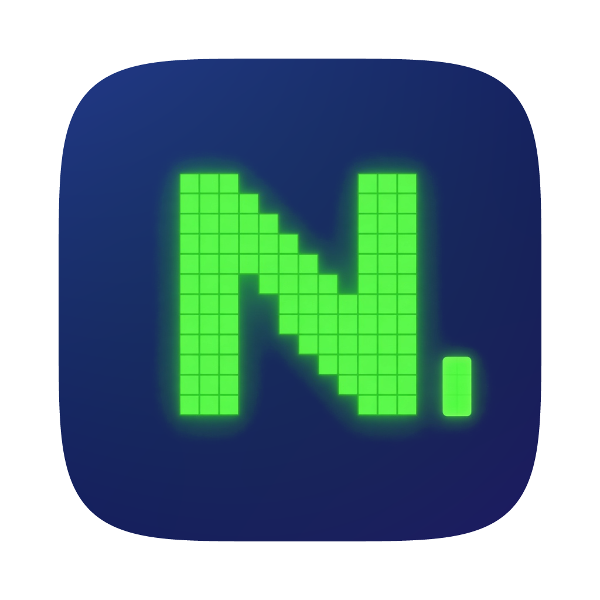

<p align="center">
  
</p>

<h1 align="center">MyGoNVim</h1>

<p align="center">
  English &middot;
  <a href="README.ja.md">日本語</a> &middot;
  <a href="README.zh-CN.md">中文</a>
</p>

<p align="center">
  A Neovim GUI for macOS and Windows, built with MyGo's native UI.
</p>

<p align="center">
  <a href="https://github.com/r404r/mygonvim/actions/workflows/ci.yml"></a>
</p>

<p align="center">
  <a href="#prebuilt-builds">Prebuilt builds</a> &middot;
  <a href="#run">Run</a> &middot;
  <a href="#mouse">Mouse</a> &middot;
  <a href="#clipboard">Clipboard</a> &middot;
  <a href="#fonts">Fonts</a> &middot;
  <a href="#portable-mode">Portable mode</a> &middot;
  <a href="#develop">Develop</a>
</p>

A [Neovim](https://neovim.io) GUI drawn with [MyGo](https://github.com/egoist/mygo)'s native UI: Go only, no cgo, no web view. Windows and macOS are the targets; Linux works for development.

It runs `nvim --embed`, keeps Neovim's cell grid in memory, and draws it cell by cell with MyGo's `ui.Shape` and `Painter.Glyphs`.

**Status: MVP step 1 (partial), version 0.0.7.** Linux has been verified (unit and integration tests, a real window, and CI): it opens files, edits and saves; syntax colors, CJK and emoji, cursor shapes per mode, window title, window resize, Ctrl/Alt/special keys. Input-method composition is drawn at the cursor in headless tests; real IME on macOS and Windows is untested. macOS and Windows compile, pass CI unit tests, and have unsigned preview builds, but have not been run on a real machine, so MVP 1 is not done. The mouse wheel and touchpad scroll the window under the pointer (tested against a real Neovim in a headless window, not yet on a real Mac or Windows machine). Mouse clicks and dragging are also tested against real Neovim in a headless window; they have not been tried on real macOS or Windows hardware. Clipboard pasting and register callbacks are tested against real Neovim with a substitute clipboard; native clipboard exchange and menu shortcuts still need real macOS and Windows testing. Not yet: high-DPI polish, command-line/popup-menu/tab-line/multigrid UI, a bundled Neovim, or signed/notarized packages. Design notes are maintained separately.

## Prebuilt builds

`mygo.json` is version `0.0.7`. Pushing a `v*` tag that matches that version runs [`.github/workflows/release.yml`](.github/workflows/release.yml), which attaches macOS arm64 and amd64 `.app` zips and `.dmg` files, and a Windows amd64 portable zip (an empty `data/` folder included; Neovim is not bundled), to a **draft** GitHub Release. The v0.0.1, v0.0.2, v0.0.3 and v0.0.4 releases remain unpublished drafts.

Those builds are unsigned. The macOS apps are ad hoc signed and not notarized; Gatekeeper will likely block them on other Macs. The builds declare macOS 13.0 as the minimum (`macos.minimumSystemVersion` in `mygo.json`).

If Gatekeeper blocks the app, first Control-click (right-click) it in Finder and choose Open. If that still fails, copy the app to Applications when it came from a `.dmg`, then run:

    xattr -dr com.apple.quarantine /path/to/MyGoNVim.app

This method has not been verified on a real Mac.

## Run

Needs Go 1.27.3 or later (what MyGo requires) and Neovim on `PATH` (or pass `-nvim`). Developed and tested with Neovim 0.12 (v0.12.6 in our tests); older versions are untested.

```sh
# macOS
brew install neovim go
git clone https://github.com/r404r/mygonvim && cd mygonvim
go run . path/to/file.txt          # or: go tool mygo dev
```

```
usage: mygonvim [flags] [file ...]
  -nvim string        path of the nvim executable (default: $MYGONVIM_NVIM, ./nvim/bin, PATH)
  -font string        font family list, e.g. "JetBrains Mono, monospace"
  -font-size float    font size in DIPs (default 14)
  -width, -height     window size in DIPs (default 1000x650)
  -version            print the version and exit
```

`mygonvim -version` prints `MyGoNVim <version>`. `go run` and tests use `dev`. A release build sets the version from `mygo.json` (`go tool mygo build` links it into the app) and with `-ldflags="-X main.version=…"` or the `MYGO_LDFLAGS` environment variable (which `go tool mygo build` appends). The two should be the same string, without a leading `v`.

Where nvim is looked for: `-nvim`, `$MYGONVIM_NVIM`, `nvim/bin/nvim[.exe]` or `nvim/nvim[.exe]` next to the program (and in the app's resources folder), `PATH`, then `/opt/homebrew/bin` and `/usr/local/bin` on macOS.

Dropping files from Finder or Explorer on the window opens them: MyGoNVim runs `:confirm drop {files}` with the names quoted for Neovim, including literal `[` characters in existing Windows paths. A dropped directory opens in Neovim's file explorer. The first file is shown (or its window is focused if it is already open), and with several files they all go to the argument list. Neovim asks on its command line when the current buffer has unsaved changes. The command is tested against a real Neovim; the drop gesture itself has not been tried on a real macOS or Windows machine. Dropping on the Dock icon, and "Open With", are not handled yet.

**File > Open...** shows the system file dialog (several files can be chosen) and opens the choice the same way as a drop. On macOS the shortcut is Cmd+O, and the app, Edit and Window menus and File > Close stay. On Windows the File menu has Open... and Exit without shortcuts, so Ctrl+O (jump list), Ctrl+W and Ctrl+Q stay with Neovim; Linux gets the same menu. Both have a Font menu (see Fonts). Cancelling the dialog does nothing. The menu has not been tried on a real macOS or Windows machine.

Closing the window runs `:confirm qa`: Neovim asks about unsaved changes on its own command line, and the window closes when Neovim has quit.

File > Exit and the application Quit action use the same confirmation path. During OS logout or shutdown, MyGo ignores cancellation of window close events; the application cannot keep the window open for this prompt. Save your work before ending the OS session. Native close gestures still need macOS and Windows testing.

### Logs

RPC request failures and `nvim_error_event` notifications are written to `mygonvim.log` in MyGo's application log directory (`PathLogs`). In portable mode this is `data/mygonvim/logs/mygonvim.log`. The log also goes to stderr when one is available. It starts over when the next write would exceed 1 MiB; an oversized existing log is cleared on startup. If the log file cannot be opened, logging continues on stderr. Error events include their type and message; a recent call name is only a hint and does not identify the failing request.

## Mouse

Left, right and middle button presses, drags and releases go to Neovim as `nvim_input_mouse`, with Shift, Ctrl, Alt and Command (Super). Neovim decides what each button and double/triple click do: left clicks place the cursor or switch splits, dragging selects text, double clicks select words and triple clicks select lines. The default right click opens Neovim's popup; the middle button puts register text. This does not add a separate GUI context menu.

Coordinates share the wheel's cell mapping and clamp to the grid edges. Drag events are sent only when the cell changes. Only one button gesture is active at a time, matching MyGo's capture model. A new press first releases the previous gesture at the current clamped cell, even for the same button; this prevents overlapping buttons from leaving a stuck drag. An active press is also released outside the window or when focus is lost. A gesture started while Neovim reports `mouse_off` is ignored until release; an already forwarded press still gets a release after `mouse_off`. Hover and side buttons are not forwarded.

Scroll events go to Neovim as `nvim_input_mouse` wheel steps at the cell under the pointer, so with split windows the one under the pointer scrolls. Each step moves what Neovim's `mousescroll` option defaults to: three lines up or down, six columns sideways. The editor assumes that default; a changed `mousescroll` is not read.

- **Mouse wheel**: one step per notch; a fast turn that the system accelerates gives several steps.
- **Touchpad**: the pixels of the gesture add up and one step goes out each time they reach three lines (six columns sideways), so a small movement does nothing until it adds up, and a pause of 0.3 seconds or a change of direction starts the count again. The momentum after the fingers leave arrives as more scrolling and goes the same way. The direction is the one the system reports, so macOS's "natural scrolling" setting applies as it does elsewhere.
- Shift, Ctrl, Alt and Command (Super) are passed on, so Neovim sees `<S-ScrollWheelDown>` and so on, and its mappings and defaults for them apply (by default Shift+wheel scrolls a page).
- While Neovim says its `mouse` option is off for the current mode (`mouse_off`), as with `set mouse=` or on the command line with the default `mouse=nvi`, scrolling is ignored.

Headless tests with real Neovim cover clicks, selection, split switching, double/triple clicks, right/middle buttons, modifiers, the `mouse` option and scrolling. Mouse and touchpad behavior on real macOS and Windows hardware (including capture outside the window, speed and momentum) has not been tried.

## Clipboard

Use **Edit > Paste** or **Ctrl+Shift+V** on Windows/Linux, and **Cmd+V** on macOS. Plain text goes through `nvim_paste`, preserving literal text such as `<CR>` and normalizing CRLF/CR line endings. Paste follows Neovim's mode semantics: after the cursor in Normal mode, at the cursor in Insert mode, replacing the selection in Visual/Select mode, and only the first line on the command line. Empty or non-text clipboards do nothing. Large multiline text is streamed at line boundaries with a 64 KiB target; individual long lines can exceed that size. A streamed paste is one undo step. Tests cover 1 MiB and 10 MiB inputs; native responsiveness still needs testing.

**Edit > Copy** or **Ctrl+Shift+C** copies a Visual/Select selection to the `+` register. On macOS the standard Edit menu supplies **Cmd+C**, **Cmd+V** and **Cmd+X**; Cut removes the selection using the `+` register. On macOS, **Cmd+Z** / **Edit > Undo**, **Cmd+Shift+Z** / **Edit > Redo**, and **Cmd+A** / **Edit > Select All** are supported too. Undo and Redo preserve Insert mode; Select All enters linewise Visual mode for the whole buffer. Copy and Cut do nothing without a selection. These operations bypass yank/delete mappings. **Ctrl+V stays with Neovim**, including block Visual mode. On Windows/Linux the menu consumes Ctrl+Shift+C/V before Neovim, so mappings for those combinations do not receive them.

By default MyGoNVim supplies `g:clipboard` using the native plain-text clipboard, without an external clipboard program. `"+y` / `"+p` and the `*` register use it too; both registers refer to the same system clipboard. The provider is installed at `VimEnter` only if `g:clipboard` is still unset. Your own value, including `false`, is preserved. Set a custom provider **before** calling `has('clipboard')`: Neovim caches provider detection, and changing `g:clipboard` afterward does not update it. Clipboard access during your init, before `VimEnter`, uses Neovim's built-in detection.

Native register requests and GUI clipboard reads have a two-second deadline. Read/write failures and timeouts are logged and show a one-line warning in Neovim; failed reads return empty text and failed writes are ignored. Native reads run in a windowless helper process that can be stopped at the deadline, keeping the editor's main thread available. An already running native write cannot be interrupted; pending requests are bounded, and an expired write waiting for the UI thread is skipped. Text ending in a newline is read as a linewise register; other text is characterwise. Blockwise register metadata is lost across the system clipboard. On Linux, keeping clipboard contents after exit depends on the desktop's clipboard manager.

Real Neovim tests use a substitute clipboard to verify RPC callbacks, user-provider priority, selection commands and paste behavior. They do not verify the OS clipboard, native menu dispatch, cross-application exchange or IME interaction on macOS/Windows hardware.

GUI Paste, Copy and Cut are ignored, logged and reported with a one-line warning when Neovim reports that it is waiting for a key (for example, after `"` or Insert-mode Ctrl+R). Each clipboard request has two seconds to reply; every paste chunk gets a fresh timer, so a paste that keeps receiving replies can complete even when its total duration exceeds two seconds. If a request times out, the queue continues sending later keys in order. The request already sent cannot be cancelled and may still change text or the clipboard when Neovim resumes. A paste timeout drops the remaining text, so the pasted text may be incomplete; the log records the failed request, `context deadline exceeded`, and that queued input continues and the paste may be incomplete. After the in-flight chunk returns, an empty final chunk closes a started stream, then a `MyGoNVim: paste incomplete` warning appears. One undo removes the incomplete paste. Further clipboard commands are ignored with a warning until that request and stream cleanup finish. Warnings are shortened to the available message space to avoid a Press ENTER prompt. Resize retains its existing behavior and can still delay queued input while Neovim waits for a key.

## Fonts

For the font family and for the size, separately, the first of these that has a value is used:

1. Neovim's `guifont` option, set from `init.lua` (`vim.o.guifont = "JetBrainsMono Nerd Font:h14"`) or on the fly (`:set guifont=Fira_Code:h14`). An empty `guifont` is not a choice: it leaves the next source in effect. Neither is Neovim's own default: since Neovim 0.12 `guifont` starts as a font list for the platform, and MyGoNVim asks Neovim for that default at startup and treats a `guifont` equal to it as empty (until the answer arrives, `guifont` is not used), so that it does not override `-font`.
2. The font chosen in the **Font** menu, saved in `settings.json` in the app's user data folder (`data/mygonvim/` in portable mode).
3. The `-font` and `-font-size` flags.
4. The default: `SF Mono, Menlo, monospace` on macOS, `Cascadia Mono, Consolas, monospace` on Windows, `monospace` elsewhere; 14 DIPs.

`guifont` is read like Neovim does for other GUIs: a comma separated list of fonts (the order is the fallback order), `_` in a name stands for a space, a backslash makes the next character literal, and `:hN` gives the size (a fraction is fine). The size is taken as DIPs, which are points on macOS; how that compares with points on Windows has not been checked. Only the first `:h` counts. `:b` and `:i` are parsed but not used: bold and italic text comes from the highlight groups, and the regular font stays regular. Other options (`:w`, `:c`, `:s`, ...) and `*` are ignored. A generic `monospace` is added at the end of the list, so that a name that is not installed still gives a fixed-width font. Changing the font measures the cells again and asks Neovim for the grid that fits the window.

The **Font** menu has a Family group (the fixed-width families the system reports, minus the private ones whose names start with a dot) and a Size group (10 to 28). Choosing an item applies it at once, saves it, and runs `:let &guifont = '...'` in Neovim, so that `:set guifont?` shows the same font and a plugin reading `guifont` sees it. Choosing a size keeps the current font list and changes the size of its first font. When the app starts with a saved family it sets `guifont` in Neovim before your init file runs, so an init file that sets `guifont` still wins; a `guifont` from your init file also outranks the menu's choice from the next start on. The checks in the menu follow the font in use, also when `guifont` changed it. `settings.json` is `{"fontFamily": ..., "fontSize": ...}` and other keys in it are kept; a file that cannot be read is logged and ignored, and the next choice replaces it. The menu has no shortcuts.

This is tested with a real Neovim on Linux. A font such as a Nerd Font on a real Mac or Windows machine has not been tried, nor has the Font menu there (which families it lists, how it looks with many items, whether the radio checks show).

## Portable mode

If a `data/` folder sits next to the program, Neovim's `XDG_CONFIG_HOME`, `XDG_DATA_HOME`, `XDG_STATE_HOME` and `XDG_CACHE_HOME` point into `data/config`, `data/share`, `data/state` and `data/cache`, and the app's own user data goes to `data/mygonvim`.

`go run` puts the executable in a temporary directory, so a `data/` folder in the source tree does not enable portable mode. Build a binary first (`go build -o mygonvim .` or `go tool mygo build`) and place `data/` next to that binary. For a macOS `.app`, the executable lives in `Contents/MacOS/`; whether `data/` should sit there or next to the `.app` has not been verified.

A Windows portable folder is then:

```
MyGoNVim.exe        go tool mygo build -platform windows/amd64 -skip-installer
nvim/bin/nvim.exe   unzip of Neovim's nvim-win64.zip (nvim/share, nvim/lib too)
data/               your config and plugins live here
```

On Windows the process is started with `CREATE_NO_WINDOW`, which is intended to avoid a console flash; that has not been checked on a real machine. A clean Windows 10 may need the Visual C++ runtime (`VCRUNTIME140.dll`) beside `nvim.exe` (also unverified on a clean VM).

## Develop

```sh
go vet ./... && go test ./...                     # the window tests use a headless MyGo window
NVIM_BIN=/path/to/nvim go test ./...              # also runs the tests against a real nvim --embed
MYGONVIM_SCREENSHOT=shot.png NVIM_BIN=... go test -run RealNvim ./internal/gui
CGO_ENABLED=0 GOOS=windows GOARCH=amd64 go build .
```

CI runs `go vet ./...` and all package tests on Linux, macOS and Windows,
including headless MyGo views and real `nvim --embed` sessions. All three
runners download the official Neovim release pinned by `NVIM_VERSION` in
`.github/workflows/ci.yml`. Linux also uses `-race`; macOS and Windows run
without it. The four cross-build targets continue to use `CGO_ENABLED=0`.

CI sets `NVIM_BIN` to the downloaded executable's absolute path: a missing
or broken executable fails the real Neovim tests instead of skipping them.
Locally, those tests skip when neither `NVIM_BIN` nor Neovim on `PATH` is
available. Test events, including individual passes and skips with reasons,
are in the job logs and the `test-results-*` artifacts (`go test -json`).
Windows skips only file-opening cases with names its filesystem forbids;
the escaping comparison against Neovim still covers those characters.
These CI checks do not verify native menus, real input methods, gestures,
or packaged applications on a physical Windows or macOS machine.

Layout: `internal/grid` (screen model from `redraw` events), `internal/input` (keys and IME to `nvim_input` notation; scroll events to wheel steps), `internal/nvimproc` (find, start and talk to nvim), `internal/appmenu` (the menu bar), `internal/openfiles` (paths to the Ex command that opens them), `internal/fontcfg` (which font wins; `guifont` parsing), `internal/gui` (the MyGo view that draws the grid). MyGo is pinned in `go.mod` to the release v0.9.0.

## License

MIT
