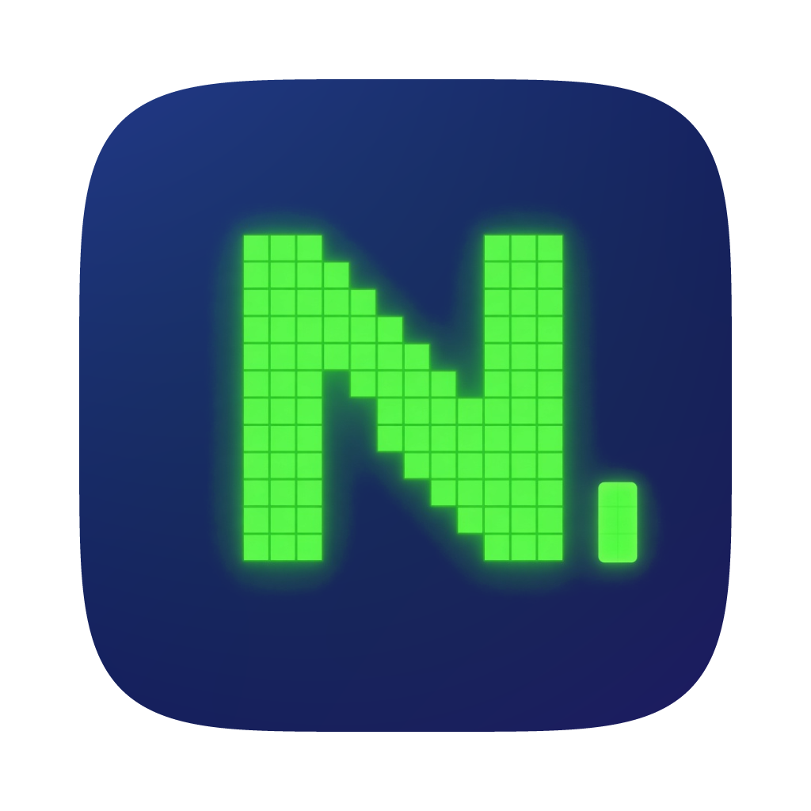

<p align="center">
  
</p>

<h1 align="center">MyGoNVim</h1>

<p align="center">
  <a href="README.md">English</a> &middot;
  <a href="README.ja.md">日本語</a> &middot;
  中文
</p>

<p align="center">
  面向 macOS 与 Windows 的 Neovim 图形界面，使用 MyGo 的原生 UI 构建。
</p>

<p align="center">
  <a href="https://github.com/r404r/mygonvim/actions/workflows/ci.yml"></a>
</p>

<p align="center">
  <a href="#预构建版本">预构建版本</a> &middot;
  <a href="#运行">运行</a> &middot;
  <a href="#鼠标">鼠标</a> &middot;
  <a href="#剪贴板">剪贴板</a> &middot;
  <a href="#字体">字体</a> &middot;
  <a href="#便携模式">便携模式</a> &middot;
  <a href="#开发">开发</a>
</p>

用 [MyGo](https://github.com/egoist/mygo) 的原生 UI 绘制的 [Neovim](https://neovim.io) 图形界面：只有 Go，没有 cgo，没有 web view。目标平台是 Windows 和 macOS；Linux 可用于开发。

它运行 `nvim --embed`，把 Neovim 的单元格网格保存在内存中，并用 MyGo 的 `ui.Shape` 和 `Painter.Glyphs` 逐格绘制。

**状态：MVP 第 1 步（部分完成），版本 0.0.10。** Linux 已经验证（单元测试与集成测试、一个真实窗口，以及 CI）：可以打开文件、编辑并保存；语法着色、CJK 与 emoji、按模式变化的光标形状、窗口标题、调整窗口大小、Ctrl/Alt/特殊键。输入法组合串在无头测试中绘制在光标处；macOS 与 Windows 上的真实 IME 未经测试。macOS 和 Windows 可以编译，能通过 CI 单元测试，也有未签名的预览构建，但还没有在真实机器上运行过，因此 MVP 1 并未完成。鼠标滚轮和触控板会滚动指针下方的窗口（已在无头窗口里对真实 Neovim 测试，尚未在真实的 Mac 或 Windows 机器上测试）。鼠标点击和拖动也已在无头窗口里对真实 Neovim 测试；尚未在真实的 macOS 或 Windows 硬件上尝试。剪贴板粘贴和寄存器回调已用替代剪贴板对真实 Neovim 测试；原生剪贴板交换和菜单快捷键仍需要在真实的 macOS 和 Windows 上测试。尚未具备：高 DPI 打磨、命令行 / 弹出菜单 / 标签栏 / 多网格 UI、捆绑的 Neovim，或已签名 / 已公证的包。设计文档另行维护。

## 预构建版本

`mygo.json` 的版本是 `0.0.10`。推送与该版本匹配的 `v*` 标签会运行 [`.github/workflows/release.yml`](.github/workflows/release.yml)，把 macOS arm64 与 amd64 的 `.app` zip 和 `.dmg`，以及 Windows amd64 便携 zip（包含一个空的 `data/` 文件夹；不捆绑 Neovim），附加到**草稿** GitHub Release。并非每个标签都有公开的 Release；已公开的版本以本仓库的 [Releases 页面](https://github.com/r404r/mygonvim/releases)为准。

这些构建没有签名。macOS 应用是 ad hoc 签名，且未经公证；Gatekeeper 很可能会在其他 Mac 上拦截它们。构建声明的最低系统是 macOS 13.0（`mygo.json` 中的 `macos.minimumSystemVersion`）。

如果 Gatekeeper 拦截了应用，先在 Finder 里 Control-click（右键单击）它，并选择 Open。如果仍然失败，当它来自 `.dmg` 时，把应用复制到 Applications，然后运行：

    xattr -dr com.apple.quarantine /path/to/MyGoNVim.app

此方法尚未在真实的 Mac 上验证。

## 运行

需要 Go 1.27.3 或更高版本（MyGo 所要求的版本），以及 `PATH` 上的 Neovim（或传入 `-nvim`）。开发与测试使用 Neovim 0.12（测试中为 v0.12.6）；更早的版本未经测试。

```sh
# macOS
brew install neovim go
git clone https://github.com/r404r/mygonvim && cd mygonvim
go run . path/to/file.txt          # or: go tool mygo dev
```

```
usage: mygonvim [flags] [file ...]
  -nvim string        path of the nvim executable (default: $MYGONVIM_NVIM, ./nvim/bin, PATH)
  -font string        font family list, e.g. "JetBrains Mono, monospace"
  -font-size float    font size in DIPs (default 14)
  -width, -height     window size in DIPs (default 1000x650)
  -version            print the version and exit
```

`mygonvim -version` 会打印 `MyGoNVim <version>`。`go run` 和测试使用 `dev`。发布构建从 `mygo.json` 设置版本（`go tool mygo build` 会把它链接进应用），也可以用 `-ldflags="-X main.version=…"` 或环境变量 `MYGO_LDFLAGS`（`go tool mygo build` 会追加它）。二者应当是同一个字符串，且开头不要加 `v`。

查找 nvim 的位置：`-nvim`、`$MYGONVIM_NVIM`、程序旁边的 `nvim/bin/nvim[.exe]` 或 `nvim/nvim[.exe]`（以及应用的 resources 文件夹中）、`PATH`，然后在 macOS 上是 `/opt/homebrew/bin` 和 `/usr/local/bin`。

从 Finder 或 Explorer 把文件拖到窗口上即可打开：MyGoNVim 会执行 `:confirm drop {files}`，文件名按 Neovim 的规则加引号，包括现有 Windows 路径里的字面 `[` 字符。拖入的目录会在 Neovim 的文件浏览器中打开。会显示第一个文件（如果它已经打开，则聚焦它的窗口）；有多个文件时，它们都会进入参数列表。当前缓冲区有未保存的修改时，Neovim 会在自己的命令行上询问。该命令已对真实 Neovim 测试；拖放这个动作本身尚未在真实的 macOS 或 Windows 机器上尝试。拖到 Dock 图标上，以及 "Open With"，都还没有处理。

**File > Open...**（文件 > 打开...）会显示系统文件对话框（可以选择多个文件），并按与拖放相同的方式打开所选文件。在 macOS 上，快捷键是 Cmd+O，并且保留 app（应用程序）、Edit（编辑）和 Window（窗口）菜单以及 File > Close（文件 > 关闭）。在 Windows 上，File 菜单有不带快捷键的 Open... 和 Exit（退出），因此 Ctrl+O（跳转列表）、Ctrl+W 和 Ctrl+Q 仍留给 Neovim；Linux 使用同一套菜单。两者都有 Font（字体）菜单（见「字体」）。取消对话框不会做任何事。此菜单尚未在真实的 macOS 或 Windows 机器上尝试。

关闭窗口会运行 `:confirm qa`：Neovim 在自己的命令行上询问未保存的修改，Neovim 退出后窗口关闭。

File > Exit 和应用程序的 Quit（退出）动作使用同一条确认路径。在操作系统注销或关机期间，MyGo 会忽略对窗口关闭事件的取消；应用程序不能为了这次提示而把窗口保持打开。结束操作系统会话之前请先保存工作。原生的关闭手势仍需要在 macOS 和 Windows 上测试。

### macOS 登录 shell 环境

默认情况下，macOS 启动的父进程为 launchd（PID 1）、且 stdout 不是终端时，会导入登录 shell 导出的环境。这涵盖访达 / Dock 启动；终端直接执行通常沿用继承的环境。先开窗口，导入结束后再启动 Neovim。shell 依次取 `$SHELL`、账户的 `UserShell`、`/bin/zsh`；只接受可执行的绝对路径，文件名须为 `zsh` 或 `bash`。每次启动执行一次 `-l -i -c`，stdin 为 null 设备，工作目录为主目录。不把环境快照缓存到磁盘。

PATH 先放 shell 条目，再追加继承环境独有的条目并去重；查找 Neovim 也使用这个 PATH。便携 `XDG_*` 路径与继承的 `MYGONVIM_*` 控制保持生效。非便携模式中，shell 设置的 `XDG_CONFIG_HOME` 或 `NVIM_APPNAME` 可能选择另一套 Neovim 配置。shell 的 `unset` 不删除继承的变量。不设置或导入 `TERM`，`:checkhealth` 的 Terminal 一节仍可能报告缺失。

在应用的 `settings.json` 设置 `"loginEnv": false`，或启动时设置 `MYGONVIM_LOGIN_ENV=0` 即可关闭。`MYGONVIM_LOGIN_ENV=1` 覆盖设置和启动判定（也允许在 Linux 上显式运行 Unix 诊断探测）。继承了 `MYGONVIM_LOGIN_ENV_PROBE` 时始终禁止再次探测，即使强制 `=1`；探测进程将其设为 `1`，供 shell 启动文件跳过重活。Windows 不执行探测。About 显示 Pending、Imported、Skipped 或 Fallback 及其原因。

超时（5 秒）、不支持的 shell、格式错误或不完整的输出、输出超过 1 MiB 时，回退到继承环境，不弹导入错误对话框。探测日志只记计数、耗时、退出状态与 shell 文件名，不记变量值或 shell 原始输出；`MYGONVIM_LOGIN_ENV_DEBUG=1` 才额外记变量名。导出的凭据会传给 Neovim 及其子进程，与终端启动相同；每次探测都会执行启动文件。不支持 fish 等其他 shell；direnv 这类提示符 / 目录钩子可能不执行，bash 登录 profile 若需要 `.bashrc` 的设置须主动 source。终端中后台化、重定向 stdout 后父进程变为 PID 1 的进程可能被误判而重复导入。访达 / Dock 行为与启动耗时仍待 macOS 真机测试。

等待启动期间，键盘输入、文本粘贴和命令按到达顺序暂存，合计最多 1 MiB、1024 个请求。Neovim 就绪后，先应用最新窗口尺寸，再补发暂存请求。超过任一上限的新请求会被整项忽略，并记一次不含内容的日志；启动失败或取消时丢弃暂存。会话就绪前的鼠标事件会被忽略。

### 日志输出

RPC 请求失败和 `nvim_error_event` 通知会写到 MyGo 应用程序日志目录（`PathLogs`）中的 `mygonvim.log`。在便携模式下，路径是 `data/mygonvim/logs/mygonvim.log`。当 stderr 可用时，日志也会写到 stderr。下一次写入将超过 1 MiB 时，日志从头开始写。启动时会清掉已经过大的现有日志。如果无法打开日志文件，日志继续写到 stderr。错误事件包含其类型和消息；最近一次调用名只是提示，并不能确定是哪一个请求失败。

## 鼠标

左键、右键和中键的按下、拖动与释放，连同 Shift、Ctrl、Alt 和 Command（Super），以 `nvim_input_mouse` 发给 Neovim。每个按键以及双击 / 三击做什么，由 Neovim 决定：左键点击放置光标或切换分屏，拖动选择文本，双击选择单词，三击选择整行。默认的右键打开 Neovim 的弹出菜单；中键放入寄存器中的文本。这不会另外增加一个 GUI 上下文菜单。

坐标与滚轮共用同一套单元格映射，并钳制到网格边缘。拖动事件只在单元格发生变化时发送。同一时间只有一个按键手势处于活动状态，与 MyGo 的捕获模型一致。新的按下会先在当前钳制后的单元格上释放上一个手势，即使是同一个按键；这是为了避免重叠的按键留下卡住的拖动。活动中的按下在移出窗口或失去焦点时也会被释放。在 Neovim 报告 `mouse_off` 期间开始的手势会被忽略，直到释放；已经转发过的按下，在 `mouse_off` 之后仍会收到一次释放。悬停和侧键不会转发。

滚动事件以指针所在单元格上的 `nvim_input_mouse` 滚轮步进发给 Neovim，因此有分屏时，滚动的是指针下面的那个窗口。每一步移动的量是 Neovim 的 `mousescroll` 选项的默认值：上下三行，左右六列。编辑器假定的是这个默认值；被改过的 `mousescroll` 不会被读取。

- **鼠标滚轮**：每一格一个步进；被系统加速的快速转动会产生多个步进。
- **触控板**：手势的像素会累加，每达到三行（左右为六列）就发出一个步进，因此很小的移动在累加够之前不会有动作；暂停 0.3 秒或改变方向会重新开始计数。手指离开之后的惯性会作为更多滚动到达，方向相同。方向是系统报告的方向，因此 macOS 的 "natural scrolling" 设置会像在其他地方一样生效。
- Shift、Ctrl、Alt 和 Command（Super）会一并传递，因此 Neovim 会看到 `<S-ScrollWheelDown>` 等，对应的映射和默认行为会生效（默认情况下，Shift+滚轮滚动一页）。
- 当 Neovim 表示当前模式的 `mouse` 选项为关闭（`mouse_off`）时，例如 `set mouse=`，或在默认 `mouse=nvi` 下的命令行上，滚动会被忽略。

使用真实 Neovim 的无头测试覆盖了点击、选择、分屏切换、双击 / 三击、右键 / 中键、修饰键、`mouse` 选项和滚动。真实 macOS 与 Windows 硬件上的鼠标和触控板行为（包括窗口外的捕获、速度和惯性）尚未尝试。

## 剪贴板

在 Windows/Linux 上使用 **Edit > Paste**（编辑 > 粘贴）或 **Ctrl+Shift+V**，在 macOS 上使用 **Cmd+V**。纯文本经过 `nvim_paste`，保留 `<CR>` 这样的字面文本，并把 CRLF/CR 换行规范化。粘贴遵循 Neovim 的模式语义：Normal 模式在光标之后，Insert 模式在光标处，Visual/Select 模式替换选区，命令行上只有第一行。空剪贴板或非文本剪贴板不会做任何事。较大的多行文本按行边界流式发送，目标大小为 64 KiB；单独的长行可以超过这个大小。一次流式粘贴是一个 undo 步骤。测试覆盖 1 MiB 和 10 MiB 的输入；原生环境下的响应速度仍需要测试。

**Edit > Copy**（编辑 > 复制）或 **Ctrl+Shift+C** 把 Visual/Select 选区复制到 `+` 寄存器。在 macOS 上，标准 Edit 菜单提供 **Cmd+C**、**Cmd+V** 和 **Cmd+X**；Cut（剪切）使用 `+` 寄存器移除选区。在 macOS 上，还支持 **Cmd+Z** / **Edit > Undo**（编辑 > 撤销）、**Cmd+Shift+Z** / **Edit > Redo**（编辑 > 重做），以及 **Cmd+A** / **Edit > Select All**（编辑 > 全选）。Undo 和 Redo 会保持 Insert 模式；Select All 会对整个缓冲区进入按行（linewise）的 Visual 模式。没有选区时，Copy 和 Cut 不会做任何事。这些操作会绕过 yank/delete 映射。**Ctrl+V 仍留给 Neovim**，包括块状 Visual 模式。在 Windows/Linux 上，菜单会在 Neovim 之前吃掉 Ctrl+Shift+C/V，因此这些组合的映射收不到它们。

默认情况下，MyGoNVim 用原生纯文本剪贴板提供 `g:clipboard`，不需要外部剪贴板程序。`"+y` / `"+p` 和 `*` 寄存器也使用它；两个寄存器指向同一个系统剪贴板。仅当 `g:clipboard` 仍未设置时，才在 `VimEnter` 安装这个提供方。你自己的值，包括 `false`，会予以保留。请在调用 `has('clipboard')` **之前**设置自定义提供方：Neovim 会缓存提供方检测，之后再改 `g:clipboard` 不会更新它。在 `VimEnter` 之前、init 期间访问剪贴板，使用的是 Neovim 内置的检测。

原生寄存器请求和 GUI 剪贴板读取的期限是两秒。读写失败和超时会被记入日志，并在 Neovim 里显示一行警告；失败的读取返回空文本，失败的写入被忽略。原生读取在一个无窗口的辅助进程中运行，可以在期限到达时停掉，从而使编辑器的主线程保持可用。已经在进行的原生写入不能被打断；挂起的请求数量有上限，正在等待 UI 线程而已过期的写入会被跳过。以换行结尾的文本按行（linewise）寄存器读取；其他文本按字符（characterwise）读取。按块（blockwise）寄存器的元数据在经过系统剪贴板后会丢失。在 Linux 上，退出之后能否保留剪贴板内容，取决于桌面的剪贴板管理器。

真实 Neovim 测试使用替代剪贴板来验证 RPC 回调、用户提供方的优先级、选择命令和粘贴行为。它们不验证 macOS/Windows 硬件上的操作系统剪贴板、原生菜单分发、跨应用交换或与 IME 的交互。

当 Neovim 报告自己正在等待按键时（例如在 `"` 之后，或 Insert 模式的 Ctrl+R），GUI 的 Paste、Copy 和 Cut 会被忽略、记入日志，并用一行警告报告出来。每个剪贴板请求有两秒时间回复；粘贴的每一块都会得到一个新的计时器，因此只要持续收到回复，一次粘贴即使总时长超过两秒也可以完成。如果某个请求超时，队列会按顺序继续发送后面的按键。已经发出的请求不能取消，Neovim 恢复之后仍可能改变文本或剪贴板。粘贴超时会丢掉剩余文本，因此粘贴出来的文本可能不完整；日志会记录失败的请求、`context deadline exceeded`，以及队列中的输入会继续、粘贴可能不完整。正在处理的分块返回之后，一个空的最后分块会关闭已经开始的流，然后出现 `MyGoNVim: paste incomplete` 警告。一次 undo 会去掉这次不完整的粘贴。在该请求和流清理结束之前，后续的剪贴板命令会被忽略，并给出警告。警告会缩短到可用的消息宽度，以避免出现 Press ENTER 提示。调整大小保持原有行为，在 Neovim 等待按键时仍可能延迟队列中的输入。

## 字体

字体家族和字号分开判断，各自使用下面第一个有值的来源：

1. Neovim 的 `guifont` 选项，由 `init.lua` 设置（`vim.o.guifont = "JetBrainsMono Nerd Font:h14"`），或临时设置（`:set guifont=Fira_Code:h14`）。空的 `guifont` 不算一次选择：它会让下一个来源继续生效。Neovim 自己的默认值也不算：从 Neovim 0.12 起，`guifont` 一开始就是面向该平台的字体列表，MyGoNVim 会在启动时向 Neovim 询问这个默认值，并把与之相等的 `guifont` 当作空（在答案到达之前不使用 `guifont`），这样它就不会覆盖 `-font`。
2. 在 **Font** 菜单中选择的字体，保存在应用用户数据文件夹里的 `settings.json` 中（便携模式下为 `data/mygonvim/`）。
3. `-font` 和 `-font-size` 标志。
4. 默认值：macOS 上为 `SF Mono, Menlo, monospace`，Windows 上为 `Cascadia Mono, Consolas, monospace`，其他平台为 `monospace`；字号为 14 DIPs。

`guifont` 的读取方式与 Neovim 对其他 GUI 的做法相同：逗号分隔的字体列表（顺序就是回退顺序），名字里的 `_` 表示空格，反斜杠使下一个字符按字面处理，`:hN` 给出字号（小数也可以）。字号按 DIPs 理解，在 macOS 上就是点；这与 Windows 上的点如何对应，尚未核对。只有第一个 `:h` 有效。`:b` 和 `:i` 会被解析但不使用：粗体和斜体来自高亮组，常规字体保持常规。其他选项（`:w`、`:c`、`:s`、...）和 `*` 会被忽略。列表末尾会加上通用的 `monospace`，因此一个未安装的名字仍然能得到等宽字体。更换字体后会重新测量单元格，并请 Neovim 给出适合该窗口的网格。

**Font** 菜单有一个 Family 分组（系统报告的等宽字体家族，去掉名字以点开头的私有字体）和一个 Size 分组（10 到 28）。选中一项会立即应用、保存，并在 Neovim 中运行 `:let &guifont = '...'`，这样 `:set guifont?` 会显示同一字体，读取 `guifont` 的插件也能看到它。选择字号会保留当前字体列表，并改变其中第一个字体的字号。当应用带着已保存的字体家族启动时，会在你的 init 文件运行之前在 Neovim 里设置 `guifont`，因此 init 文件里设置的 `guifont` 仍然优先；来自 init 文件的 `guifont` 从下一次启动起也会压过菜单的选择。菜单里的勾选跟随正在使用的字体，在 `guifont` 改变了字体时也是如此。`settings.json` 的形式是 `{"fontFamily": ..., "fontSize": ...}`，其中的其他键会保留；无法读取的文件会被记入日志并忽略，下一次选择会替换它。此菜单没有快捷键。

这一点是在 Linux 上用真实 Neovim 测试的。诸如 Nerd Font 这样的字体尚未在真实的 Mac 或 Windows 机器上尝试，那里的 Font 菜单也没有尝试过（它会列出哪些家族、项目很多时看起来如何、单选勾选是否显示）。

## 便携模式

如果程序旁边有一个 `data/` 文件夹，Neovim 的 `XDG_CONFIG_HOME`、`XDG_DATA_HOME`、`XDG_STATE_HOME` 和 `XDG_CACHE_HOME` 会分别指向 `data/config`、`data/share`、`data/state` 和 `data/cache`，应用自己的用户数据则放到 `data/mygonvim`。

`go run` 把可执行文件放在临时目录里，因此源码树中的 `data/` 文件夹不会启用便携模式。请先构建二进制（`go build -o mygonvim .` 或 `go tool mygo build`），再把 `data/` 放在该二进制旁边。对于 macOS 的 `.app`，可执行文件位于 `Contents/MacOS/`；`data/` 应该放在那里，还是放在 `.app` 旁边，尚未验证。

Windows 便携文件夹如下：

```
MyGoNVim.exe        go tool mygo build -platform windows/amd64 -skip-installer
nvim/bin/nvim.exe   unzip of Neovim's nvim-win64.zip (nvim/share, nvim/lib too)
data/               your config and plugins live here
```

在 Windows 上，进程以 `CREATE_NO_WINDOW` 启动，用意是避免控制台闪一下；这一点尚未在真实机器上检查。干净的 Windows 10 可能需要把 Visual C++ 运行库（`VCRUNTIME140.dll`）放在 `nvim.exe` 旁边（在干净的虚拟机上也未经验证）。

## 开发

```sh
go vet ./... && go test ./...                     # the window tests use a headless MyGo window
NVIM_BIN=/path/to/nvim go test ./...              # also runs the tests against a real nvim --embed
MYGONVIM_SCREENSHOT=shot.png NVIM_BIN=... go test -run RealNvim ./internal/gui
CGO_ENABLED=0 GOOS=windows GOARCH=amd64 go build .
```

CI 在 Linux、macOS 和 Windows 上运行 `go vet ./...` 以及全部包测试，包括无头的 MyGo 视图和真实的 `nvim --embed` 会话。三个运行器都会下载由 `.github/workflows/ci.yml` 中 `NVIM_VERSION` 固定的官方 Neovim 发行版。Linux 还会使用 `-race`；macOS 和 Windows 运行时不使用它。四个交叉构建目标继续使用 `CGO_ENABLED=0`。

CI 把 `NVIM_BIN` 设为所下载可执行文件的绝对路径：可执行文件缺失或损坏时，真实 Neovim 测试会失败，而不是被跳过。在本地，当既没有 `NVIM_BIN`、`PATH` 上也没有 Neovim 时，这些测试会跳过。测试事件，包括逐条通过和带原因的跳过，位于作业日志和 `test-results-*` 产物中（`go test -json`）。Windows 只跳过其文件系统不允许的文件名的打开文件用例；与 Neovim 对照的转义比较仍然覆盖这些字符。这些 CI 检查并不验证物理 Windows 或 macOS 机器上的原生菜单、真实输入法、手势，或已经打包的应用程序。

布局：`internal/grid`（来自 `redraw` 事件的屏幕模型）、`internal/input`（按键和输入法到 `nvim_input` 记法；滚动事件到滚轮步进）、`internal/nvimproc`（查找、启动并与 nvim 通信）、`internal/appmenu`（菜单栏）、`internal/openfiles`（把路径变成打开它们的 Ex 命令）、`internal/fontcfg`（哪一种字体生效；`guifont` 的解析）、`internal/gui`（绘制网格的 MyGo 视图）。MyGo 在 `go.mod` 中固定为发行版 v0.9.0。

## 许可证

MIT
